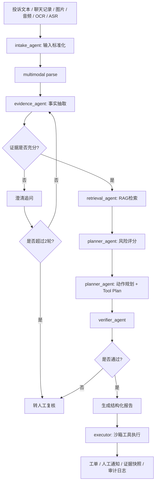

# SafeFlow-Agent

SafeFlow-Agent 是一个面向网约车安全场景的研判与自动化处置 Agent。它模拟真实业务中的安全投诉分诊流程：输入乘客投诉、司乘聊天记录、订单上下文，以及可选的图片、音频、OCR 或 ASR 文本，输出风险等级、证据引用、处置建议、人工转交决策和沙箱执行结果。

这个项目不是通用聊天 Agent，而是按真实业务复盘思路设计的安全决策系统 MVP，重点回答三个问题：

1. 如何把非结构化投诉转成可推理的事实和证据。
2. 如何让大模型在高风险场景下“受约束地推理”，而不是自由发挥。
3. 如何把安全 SOP、历史案例、工具调用和人工兜底串成可复用的 workflow。

## 业务背景

在网约车安全投诉里，单条投诉文本通常不够完整。很多案件会同时出现：

- 叙述不完整，证据缺失
- 投诉文本和订单轨迹互相矛盾
- 非安全问题伪装成安全问题
- 用户文本里夹带诱导模型误判的内容
- 高风险案件不能直接自动处置，必须保留人工兜底

因此，真正可用的系统不能只做一次 LLM 分类，而需要把“事实抽取、追问澄清、知识检索、风险排序、动作规划、二次审查、工具执行”拆成多阶段流程。

## 系统能力

项目实现了一个 `LangGraph 多角色工作流 + 规则约束 + LLM 推理 + Verifier 二次校验` 的安全决策 Agent：

- `intake_agent` 负责案件建档、输入标准化和多模态附件接入
- `evidence_agent` 负责事实抽取、证据片段整理和补充说明判断
- `retrieval_agent` 负责检索 query 构造、SOP/历史案例检索与 rerank
- `planner_agent` 负责风险评分、动作排序和工具计划生成
- `verifier_agent` 负责检查推荐动作是否被证据和 SOP 支撑，并在不安全时强制降级
- `Tool calling` 以沙箱形式模拟创建安全工单、保留证据快照和通知人工审核
- `Multimodal adapter` 支持图片/音频真实 API 解析，并保留 OCR/ASR fallback

当前版本默认采用 `API 优先` 方案，同时保留离线 heuristic fallback。没有 API key 也能完整跑通；有兼容接口时，可启用真实图片/音频解析，便于本地开发、调试和集成验证。

## 系统图



## 核心设计

### 1. 多阶段 Workflow，而不是单轮问答

主流程在 `src/safeflow_agent/workflow.py` 中实现，包含 9 个阶段：

1. 输入标准化
2. 多模态解析
3. 事实抽取
4. 是否需要澄清
5. 检索 SOP / 历史案例
6. 风险评分与排序
7. 候选动作规划与 Tool Plan
8. Verifier 二次校验
9. 报告生成与工具执行

这样设计的原因是，安全场景里的错误代价高，不能把“理解、判断、执行”混在一次生成里完成。

### 2. 规则兜底 + LLM 推理

推理层在 `src/safeflow_agent/reasoning.py` 中实现：

- 规则层负责硬约束：高危威胁、骚扰、明显路线异常必须转人工
- LLM 层负责事实整理、排序原因、动作解释
- 没有 API key 时回退到确定性 heuristic，保证项目可运行

这比纯规则更灵活，也比“纯大模型一把梭”更容易定义、审计和维护安全边界。

### 3. RAG 不是装饰，而是决策依据

检索层在 `src/safeflow_agent/retrieval.py` 中实现，知识库由两部分组成：

- 16 份合成安全 SOP
- 30+ 条合成历史案例

决策结果会显式返回 `policy_refs` 和 `evidence_spans`，方便解释“为什么这么判”。

### 4. 自动化执行必须可降级

工具层在 `src/safeflow_agent/tools.py` 中实现，目前只做沙箱动作：

- `create_safety_ticket`
- `notify_human_reviewer`

如果证据不足、检索不充分、Verifier 不通过或工具失败，系统会降级为“只给建议，不自动执行”。

## 结果与评测

评测脚本在 `src/safeflow_agent/evaluation.py` 中实现，对比了 3 个版本：

- 纯规则基线
- 单轮推理基线
- Workflow Agent

当前合成样本上的一次烟雾评测结果为：

- `rule_baseline`: severity accuracy `0.6`
- `single_turn_llm`: severity accuracy `0.6`
- `workflow_agent`: severity accuracy `0.8`
- `workflow_agent`: human recall `1.0`

这组结果基于合成数据，主要用于验证结构化 workflow 在高风险召回、流程稳定性和可解释性上的收益，不代表真实生产指标。

## 工程结构

```text
src/safeflow_agent/
  api.py
  config.py
  evaluation.py
  models.py
  reasoning.py
  retrieval.py
  seeds.py
  service.py
  store.py
  tools.py
  workflow.py
streamlit_app.py
tests/
```

## 快速启动

### 环境要求

- Python `3.11+`
- 可选：OpenAI 兼容接口，用于启用真实多模态解析和更完整的 LLM 推理

### 安装

```bash
git clone <your-repo-url>
cd SafeFlow-Agent
python -m venv .venv
source .venv/bin/activate
python -m pip install -e .[dev]
```

如果你使用 Conda，也可以执行：

```bash
conda create -n safeflow-agent python=3.11 -y
conda activate safeflow-agent
python -m pip install -e .[dev]
```

可选环境变量：

```bash
cp .env.example .env
```

然后按需填写：

```bash
OPENAI_API_KEY=your-api-key
OPENAI_BASE_URL=https://api.openai.com/v1
SAFEFLOW_LLM_MODEL=gpt-4o-mini
SAFEFLOW_VISION_MODEL=gpt-4o-mini
SAFEFLOW_AUDIO_MODEL=gpt-4o-mini
```

### 运行 Web 界面

如果你只是想快速体验界面，直接启动 Streamlit 即可。当前 `streamlit_app.py` 会在同一进程里直接调用 `SafeFlowService`，不依赖单独启动 FastAPI。

```bash
python -m pytest -q
python -m streamlit run streamlit_app.py --server.address 0.0.0.0 --server.port 8501
```

浏览器打开：

```text
http://localhost:8501
```

### Windows 本地开发

```powershell
python -m venv .venv
.venv\Scripts\Activate.ps1
python -m pip install -e .[dev]
Copy-Item .env.example .env
python -m pytest -q
python -m streamlit run streamlit_app.py
```

如果需要配置环境变量，可在 `.env` 中填写：

```powershell
$env:OPENAI_API_KEY="your-api-key"
$env:OPENAI_BASE_URL="https://api.openai.com/v1"
$env:SAFEFLOW_LLM_MODEL="gpt-4o-mini"
```

### API 服务化启动

如果你想把能力暴露成标准 HTTP 接口，再额外启动 FastAPI：

```bash
python -m uvicorn safeflow_agent.api:app --host 0.0.0.0 --port 8018 --reload --app-dir src
```

### 运行评测

```bash
python -m safeflow_agent.evaluation
```

### 运行测试

```bash
pytest
```

## Web 界面体验

新版 Streamlit 页面默认中文展示，可切换英文，便于按步骤查看高风险、低风险、多模态和澄清追问四类场景。

推荐按以下顺序体验内置样例：

1. 高风险案例：选择 `ORD-1002`
2. 低风险案例：选择 `ORD-1003`
3. 多模态案例：选择 `ORD-1004`
4. 澄清追问：选择 `ORD-1001`

推荐操作路径：

1. 在左侧点击“载入当前样例”，再点“开始评估”
2. 在右侧先看“结果总览”，查看 `风险等级 / 推荐动作 / 是否转人工`
3. 切到“证据与策略”，展示 `多模态解析结果`、`evidence_spans`、`policy_refs` 和检索到的 SOP / 历史案例
4. 切到“流程明细”，查看 `输入标准化 -> 多模态解析 -> 事实抽取 -> 澄清门控 -> 检索 -> 风险评估 -> 动作规划 -> 二次校验 -> 结构化报告` 的完整 workflow
5. 对高风险案件点击“执行沙箱动作”，展示模拟工单和人工审核通知

通过这些样例可以观察到：

- 高风险案件能清楚展示证据、策略引用和人工兜底
- 低风险案件能证明系统不会把所有投诉都升级处理
- 多模态案件能展示图片/音频解析结果是如何并入决策链的
- 信息不足案件会先澄清，而不是直接拍结论

## 设计要点

- 这是一个面向高风险业务流程的 Agent，不是开放式聊天机器人
- 核心不在于调用了多少框架，而在于把推理、排序、验证、执行拆成了受控 workflow
- 设计重点是安全边界、人工兜底、证据引用、RAG grounding 和自动化降级
- 如果后续切到本地开源模型，只需要替换 LLM 适配层，不需要推翻整个系统

## 说明

- 默认可离线运行，不依赖本地部署大模型
- 自动化执行全部是沙箱模拟，不涉及真实处罚或封禁
- 数据和知识库均为合成内容，用于功能验证与流程测试
