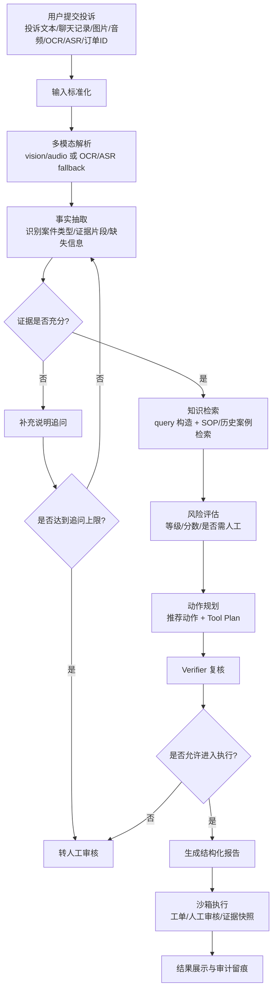
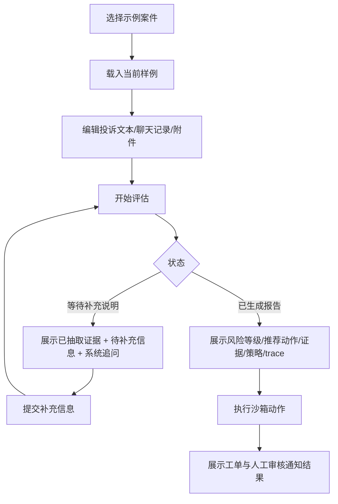

# SafeFlow-Agent：产品视角流程图

这份文档不从代码实现出发，而是从“产品怎么工作、用户会看到什么、系统为什么这么设计”来理解 SafeFlow-Agent。

## 产品定位

SafeFlow-Agent 不是聊天机器人，而是一个面向网约车安全投诉场景的智能研判与处置系统。它要解决的核心问题是：

1. 投诉信息往往不完整，不能直接下结论
2. 高风险案件不能只靠模型一次判断，必须有证据和人工兜底
3. 自动化处置不能越权，必须先在沙箱里验证流程闭环

## 产品角色

- 乘客/客服输入投诉、聊天记录、附件文本和订单信息
- SafeFlow-Agent 负责分阶段研判、追问、检索和动作建议
- 安全审核人员负责处理高风险或证据不足案件

## 产品主流程图

## 从产品设计角度怎么理解每一步

### 1. 输入标准化

目的不是“美化文本”，而是把多来源输入统一成一个案件视图。

产品价值：

- 让投诉文本、聊天记录、附件文本和订单上下文能在同一个语境下判断
- 为后续事实抽取和检索提供统一输入

### 2. 事实抽取

系统先尝试回答：

- 这是什么类型的安全事件
- 当前已经有哪些证据
- 还缺哪些关键事实

产品价值：

- 先做“理解”，再做“判断”
- 为后续追问和解释提供结构化基础

### 2.5 多模态解析

如果用户上传的是图片或音频，系统会优先尝试走真实多模态 API；如果没有可用接口，则回退到 OCR/ASR 文本。

产品价值：

- 让附件真正进入决策链，而不是只作为旁路信息
- 更贴近真实投诉场景中“图片截图、语音消息、录音证据”的使用方式

### 3. 补充说明追问

如果系统发现证据不足，它不会直接给最终结论，而是先追问。

产品价值：

- 避免在信息不全时乱判
- 提高后续结论的可信度
- 让产品在面试场景里体现“多轮推理”而不是单轮分类

### 4. 知识检索

当证据足够时，系统会检索：

- 安全 SOP
- 历史相似案例

产品价值：

- 让决策有规则依据，而不是只靠模型印象
- 为“为什么这么判”提供可解释性

### 5. 风险评估

系统结合投诉事实和订单上下文，输出：

- 风险等级
- 风险分数
- 是否需要人工介入

产品价值：

- 把模糊投诉转成可执行优先级
- 支持后续动作排序和人工资源分配

### 6. 动作规划

系统不是只打标签，还会给出动作建议，例如：

- 转人工审核
- 创建安全工单
- 转客服处理
- 关闭并持续观察

产品价值：

- 体现“智能决策系统”而不是“分类器”
- 把判断和执行连接起来

### 7. Verifier 复核

这是产品安全边界最重要的一层。

它会检查：

- 推荐动作是否有证据支撑
- 是否有 SOP grounding
- 是否应该因为高风险或证据不足而降级

产品价值：

- 避免主流程过度自信
- 让系统默认更保守

### 8. 沙箱执行

当前版本不会真的触发业务处罚，只会模拟：

- 创建安全工单
- 通知人工审核

产品价值：

- 展示“自动化执行能力”
- 同时避免真实业务风险

## 三类典型产品场景

### 场景一：高风险案件

输入：

- 偏航
- 拒绝停车
- 乘客害怕

系统表现：

- 抽到证据
- 检索到相关 SOP
- 输出高风险
- 推荐转人工审核
- 可触发沙箱工单

### 场景二：低风险案件

输入：

- 仅费用纠纷

系统表现：

- 不误判为安全事故
- 直接转客服处理

### 场景三：证据不足案件

输入：

- “感觉不太对劲”

系统表现：

- 不直接下结论
- 先追问补充信息
- 若两轮后仍不充分，则转人工

### 场景四：多模态附件案件

输入：

- 投诉主诉
- 图片或音频附件

系统表现：

- 先完成多模态解析
- 把解析结果并入事实抽取
- 再进入检索、风险评估和动作规划

## 前端交互设计

当前前端是一个“带界面的产品 demo”，不是纯展示页。每个按钮背后都直接调用了服务层，因此你可以把它理解成一个可操作的安全研判工作台。

### 页面交互流程图

### 每个按钮的产品作用

#### 1. `载入当前样例`

用户目的：

- 把侧边栏选中的 demo case 填入左侧输入区

按下后发生的事：

- 将示例案件的 `order_id`、`complaint_text`、`chat_messages` 写入当前表单
- 清空当前 run，防止旧结果干扰新演示

前端可见结果：

- 左侧输入框内容被替换为所选案例
- 页面顶部提示“已载入示例案件”

产品意义：

- 让面试演示从一个稳定、可复现的起点开始

#### 2. `清空当前运行`

用户目的：

- 去掉当前 run 的结果，重新开始一轮展示

按下后发生的事：

- 清空当前 `run_id`
- 清空提示消息

前端可见结果：

- 右侧结果区恢复到“等待一次评估”的初始状态

产品意义：

- 防止上一轮运行结果影响当前演示

#### 3. `开始评估`

用户目的：

- 提交当前案件，让系统开始完整研判

按下后发生的事：

- 前端把左侧表单内容组装成一个 `CaseInput`
- 调用 `service.evaluate_case(...)`
- 服务层创建一个新的 `WorkflowState`
- workflow 开始按阶段执行：
  - 输入标准化
  - 事实抽取
  - 澄清门控
  - 如果证据充分，则继续进入检索、风险评估、动作规划、复核、报告生成

前端拿回的结果：

- 一个 `CaseEvaluationResponse`
- 其中包含：
  - `run_id`
  - `status`
  - `clarification_questions`
  - `report`
  - `trace`
  - `tool_executions`

前端可见结果分两种：

- 如果 `status = awaiting_clarification`
  - 右侧显示已抽取证据、待补充信息和系统追问
  - 左侧出现“提交补充信息”按钮
- 如果已经生成 `report`
  - 右侧显示风险等级、推荐动作、证据、策略引用和完整 trace
  - 左侧出现“执行沙箱动作”按钮

产品意义：

- 这是主入口，决定案件是先追问还是直接进入完整决策链

#### 4. `提交补充信息`

出现条件：

- 当前 run 的状态是 `awaiting_clarification`

用户目的：

- 回答系统追问，让案件继续向后流转

按下后发生的事：

- 前端把文本框里的补充说明封装成 `ClarificationRequest`
- 调用 `service.clarify_case(...)`
- 服务层会：
  - 读取上一次 run
  - `clarification_round + 1`
  - 把补充说明追加到 `clarification_answers`
  - 重新执行 workflow

前端拿回的结果：

- 新一版 `CaseEvaluationResponse`

前端可见结果分两种：

- 如果补充后证据仍不足
  - 继续显示追问
- 如果补充后信息充分
  - 进入知识检索、风险评估、动作规划和报告生成
  - 右侧出现完整结论
  - 左侧出现“执行沙箱动作”

产品意义：

- 这是产品中体现“多轮推理”的关键交互，不是一次性判断

#### 5. `执行沙箱动作`

出现条件：

- 当前 run 已经生成 `report`

用户目的：

- 在不触发真实业务动作的前提下，验证系统的自动化处置闭环

按下后发生的事：

- 前端调用 `service.execute_case(...)`
- 服务层会读取当前 run，并调用 `workflow.execute(...)`
- `workflow.execute(...)` 根据最终动作决定模拟执行什么：
  - 如果推荐动作为 `notify_human_reviewer` 或案件本身需要人工介入
    - 创建安全工单
    - 通知人工审核
  - 如果推荐动作为 `create_safety_ticket`
    - 至少创建安全工单
  - 如果没有需要执行的动作
    - 返回 `no_op`

前端拿回的结果：

- 更新后的 `CaseEvaluationResponse`
- `tool_executions` 会出现一组沙箱执行结果

前端可见结果：

- 右侧“沙箱执行结果”区域会新增执行记录
- 常见返回包括：
  - 工单号
  - 风险等级
  - 摘要
  - 通知单号
  - 原因
  - 是否沙箱

产品意义：

- 证明这个系统不仅会判断，还能把判断映射为可控、可审计的执行动作
- 同时因为是沙箱模式，不会对真实业务产生影响

## 站在产品角度，点击 `执行沙箱动作` 后到底发生了什么

你可以这样理解：

1. 系统先确认这次 run 已经完成评估，并拿到了最终报告
2. 它读取报告中的 `recommended_action` 和 `needs_human`
3. 决定要模拟哪些动作：
   - 建工单
   - 通知人工
   - 或者什么都不做
4. 生成一组结构化执行结果
5. 把这组结果写回当前 run，并在页面展示

注意：

- 这一步不会修改真实订单
- 不会真的处罚司机
- 不会真的给安全团队发通知
- 它只是把“如果产品进入自动化执行阶段，会调用哪些工具、返回哪些结构化结果”展示出来

## 演示时该怎么讲按钮

最稳的讲法是：

1. 我先载入样例，让输入稳定可复现
2. 再点击“开始评估”，看系统是直接判断还是先追问
3. 如果系统进入补充说明，我就回答追问，展示多轮研判
4. 如果系统已经产出结论，我再点击“执行沙箱动作”，展示自动化闭环

这样讲的好处是：

- 面试官能看清“理解 -> 判断 -> 执行”的完整链路
- 每个按钮都对应明确的产品目的
- 不会把页面演示成一堆随机点击

## 你可以把这个产品概括成一句话

SafeFlow-Agent 是一个把安全投诉从“非结构化描述”转成“可解释、可审计、可降级决策”的多阶段智能研判系统。

## 和代码的对应关系

- 产品主流程：`src/safeflow_agent/workflow.py`
- 推理与澄清：`src/safeflow_agent/reasoning.py`
- 知识检索：`src/safeflow_agent/retrieval.py`
- 工具执行：`src/safeflow_agent/tools.py`
- 演示界面：`streamlit_app.py`
